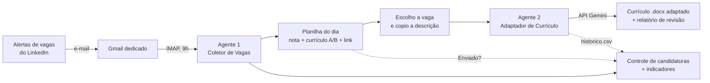

# Agente de Recolocação Profissional

[](https://github.com/pedroh83/agente-recolocacao/actions/workflows/testes.yml)

Dois agentes em Python que automatizam a minha própria busca de emprego: um **coleta e pontua vagas todos os dias** e o outro **gera um currículo em Word adaptado para cada vaga, com IA (Google Gemini) e verificação contra invenções**. Os dois alimentam um **controle único de candidaturas com indicadores**, para medir o que funciona.

Criei este projeto durante a minha transição de **Qualidade e Processos** para **Tecnologia**. Apliquei nele a mesma lógica que usei por anos em Sistemas de Gestão ISO: mapear o processo manual, identificar desperdícios, automatizar, medir e documentar em POP.

---

## O problema

Buscar vaga manualmente consumia tempo todos os dias:

- abrir o LinkedIn e rolar dezenas de vagas, muitas repetidas ou fora do perfil;
- decidir qual das minhas duas versões de currículo enviar (Qualidade/Processos ou Requisitos/Tecnologia);
- reescrever o currículo para cada vaga, com as palavras-chave certas para passar nos filtros (ATS), sem exagerar nem inventar nada;
- e, no fim, não saber o que dava resultado: qual currículo, que tipo de vaga, se adaptar valia a pena.

## A solução



### Agente 1: Coletor de Vagas
- Roda sozinho **todos os dias às 9h** pelo Agendador de Tarefas do Windows.
- Lê os e-mails de alerta de vagas do LinkedIn em um **Gmail dedicado**, via IMAP, sem marcá-los como lidos.
- Extrai título, empresa, local e link de cada vaga e **descarta as já vistas** em dias anteriores.
- Calcula uma **nota de compatibilidade** por palavras-chave com peso (3 para termos que definem a vaga, 1 para termos de apoio), com bônus para Salvador/BA e trabalho remoto ou híbrido. As listas ficam em `palavras_chave.txt`, editável sem mexer no código.
- Pede uma **segunda opinião ao Gemini** sobre os títulos de nota baixa, numa única consulta por dia, para não perder cargos com nomes fora das listas.
- Indica qual currículo enviar: **A (Qualidade & Processos)** ou **B (Requisitos & Tecnologia)**.
- Gera uma **planilha Excel** do dia, ordenada por nota, com link de candidatura e coluna "Enviado?".

### Agente 2: Adaptador de Currículo
- Uso em 3 passos: copiar a descrição da vaga no LinkedIn (Ctrl + C) e dar dois cliques no atalho **Adaptar Currículo**.
- Faz uma **pontuação local** antes da IA: quantos % dos termos da vaga aparecem em cada currículo.
- O **Gemini** escolhe a versão A ou B e reescreve o currículo para a vaga.
- Pós-processamento automático:
  - passa para o passado os verbos de empregos já encerrados;
  - **verifica a veracidade** do texto gerado contra os currículos base: empresas, números, cursos, idiomas e verbos de responsabilidade como "liderei".
- Entrega um **currículo em Word (.docx)** e um **relatório** com compatibilidade antes/depois, palavras-chave, lacunas e alertas de veracidade.
- Registra cada adaptação num histórico (CSV) e, se a IA falhar, guarda a vaga como pendente para reprocessar.

### Controle de candidaturas e indicadores (PDCA)
Uma planilha única, `controle_candidaturas.xlsx`, atualizada a cada execução do coletor:

- junta **todas as vagas** já mostradas, o "Enviado?" marcado nas planilhas do dia e as **adaptações** do Agente 2, ligadas à vaga certa por link ou por empresa e cargo;
- tem colunas para eu registrar o **retorno** de cada candidatura (entrevista, teste, proposta, recusa), que o agente **nunca apaga**;
- calcula, com fórmulas do Excel, os **indicadores** que orientam as próximas decisões:
  - funil: vagas → enviadas → retornos positivos;
  - **qual currículo (A ou B) traz mais retorno**;
  - **se adaptar o currículo aumenta a taxa de retorno**;
  - **se a nota do agente acerta** (retorno por faixa de nota), para recalibrar as palavras-chave;
  - ritmo das últimas 8 semanas.

## Destaques técnicos

| Desafio real | Solução adotada |
|---|---|
| Raspar o LinkedIn violaria os termos de uso | Leitura dos **alertas oficiais** que chegam por e-mail |
| Termos curtos casavam dentro de outras palavras (`ti` em "logística") | Comparação por **palavra inteira**, com texto normalizado (minúsculo e sem acento) |
| Termos genéricos traziam vagas fora do perfil | **Calibragem com 110 vagas reais**, ajuste de pesos e nota mínima |
| Cargos com nomes fora das listas ficavam de fora | **Segunda opinião da IA** só para os títulos de nota baixa, com o agente seguindo normalmente se a IA falhar |
| A IA "promovia" experiências ("liderei" onde era "acompanhei") ou inventava nível de idioma | **Verificação automática** contra os currículos base e alertas no relatório |
| Servidor do Gemini ocupado ou limite gratuito atingido | Nova tentativa automática, **troca de modelo** e fila de vagas pendentes |
| Links dos e-mails traziam tokens pessoais de acesso | Só o **link curto da vaga** é guardado |
| Dados preenchidos à mão não podem se perder quando a planilha é refeita | O controle é reconstruído a partir das fontes **preservando as colunas do usuário**, com gravação atômica e cópia de segurança |
| Mudança no layout dos e-mails só era percebida com o relatório vazio | **Testes automáticos** com um e-mail de exemplo, rodando no GitHub Actions a cada atualização |
| Erros invisíveis na execução agendada | Log em arquivo, saída sem buffer e tempo limite de 45 s na conexão |
| Senha perdida a cada atualização do código | Configuração e credenciais **externalizadas** em arquivo local |

## Tecnologias

| Item | Uso |
|---|---|
| Python (3.8+) | Linguagem dos dois agentes |
| IMAP (Gmail) | Leitura dos alertas de vagas |
| openpyxl | Planilha do dia e controle de candidaturas com fórmulas |
| Google Gemini API (`google-genai`) | Reescrita do currículo e segunda opinião sobre títulos |
| python-docx | Currículo adaptado em Word |
| pytest + GitHub Actions | Testes automáticos em Python 3.9 e 3.12 |
| Agendador de Tarefas do Windows + `.bat` | Execução diária e atalho de um clique |

## Decisões de projeto

- **Sem scraping.** O coletor usa os alertas oficiais do LinkedIn por e-mail.
- **Conta de e-mail dedicada.** Um eventual vazamento da senha de app atinge apenas uma caixa que só recebe alertas de vaga.
- **Veracidade acima de tudo.** O prompt proíbe inventar experiências, e o código confere o resultado. O revisor final continua sendo humano.
- **A IA ajuda, mas não decide sozinha.** As vagas aprovadas pela IA aparecem marcadas, e qualquer falha da IA só gera um aviso.
- **Privacidade (LGPD).** CPF, RG e endereço completo ficam fora dos currículos enviados à IA. Para a segunda opinião, só vão títulos de vagas.
- **Medir antes de mudar.** A calibragem das palavras-chave passa a ser decidida pelos indicadores de retorno, não por impressão.
- **Custo zero.** Python, API gratuita do Gemini e Gmail.

## Resultados

- Mais de **600 vagas novas** triadas entre agosto e outubro de 2026, de 5 a 15 por dia, já filtradas e ordenadas.
- Calibragem da pontuação feita com **110 vagas reais** (agosto/2026).
- Exemplo real de adaptação: compatibilidade estimada pela IA de **35% → 85%**.
- **51 testes automáticos** cobrindo extração, pontuação, configuração, controle, IA e as regras de veracidade do adaptador.

## Documentação

O projeto foi documentado como um sistema de gestão:

- [POP: Agente de Vagas](docs/POP_agente_de_vagas.md): configuração, rotina diária e semanal (PDCA), calibragem, tabela de falhas, como voltar à versão anterior e registro de melhorias.
- [Guia: Adaptador de Currículo](docs/guia_adaptador_curriculo.md): instalação, uso, checklist de revisão e solução de problemas.

## Estrutura

```
agente-recolocacao/
├── coletor/
│   ├── agente_vagas.py       # coordena as etapas (linha de comando)
│   ├── configuracao.py       # lê config.txt e palavras_chave.txt
│   ├── email_gmail.py        # conexão IMAP e leitura dos e-mails
│   ├── extracao.py           # vagas, empresa, local e link limpo a partir do HTML
│   ├── pontuacao.py          # nota por palavras-chave com peso
│   ├── ia_titulos.py         # segunda opinião do Gemini sobre títulos de nota baixa
│   ├── planilha_dia.py       # planilha do dia
│   ├── controle.py           # controle de candidaturas e indicadores
│   ├── texto.py              # normalização de texto
│   ├── palavras_chave.txt    # listas editáveis dos currículos A e B
│   ├── diagnostico.py        # testa o login e mostra o que há na conta de e-mail
│   ├── inspecionar.py        # mostra as vagas reconhecidas em cada e-mail
│   ├── rodar_agente.bat      # execução diária pelo Agendador, com log
│   ├── testar_agora.bat      # execução manual, mostrando tudo na tela
│   ├── config.example.txt    # modelo de configuração (sem senha)
│   ├── requirements.txt
│   └── tests/                # testes + e-mail de alerta de exemplo (dados fictícios)
├── adaptador/
│   ├── adaptador.py          # pontuação, chamada ao Gemini, verificação e geração do .docx
│   ├── instalar.bat          # instala bibliotecas e abre o assistente de configuração
│   ├── colar_vaga.bat        # adapta a vaga copiada com Ctrl + C
│   ├── adaptar_vagas.bat     # processa as vagas salvas na pasta "vagas"
│   ├── adaptar_vagas_agendado.bat
│   ├── testar.bat            # confere configuração, currículos e conexão
│   ├── criar_atalho.bat      # cria o atalho na Área de Trabalho
│   ├── config_adaptador.example.txt
│   ├── requirements.txt
│   ├── LEIA-ME.txt
│   └── tests/                # testes das regras de veracidade, com a IA simulada
├── docs/
│   ├── POP_agente_de_vagas.md
│   └── guia_adaptador_curriculo.md
└── .github/workflows/testes.yml
```

## Como executar

1. Instale o Python 3 marcando **Add python.exe to PATH**.
2. **Coletor:**
   ```
   cd coletor
   pip install -r requirements.txt
   copy config.example.txt config.txt
   ```
   Preencha o Gmail e a senha de app no `config.txt` e rode:
   ```
   python agente_vagas.py --debug
   ```
   Para rodar todo dia às 9h, agende o `rodar_agente.bat` no Agendador de Tarefas do Windows. Detalhes no [POP](docs/POP_agente_de_vagas.md).
3. **Adaptador:** dentro da pasta `adaptador`, dê dois cliques em `instalar.bat`. Ele instala as bibliotecas e abre um assistente que pede a chave gratuita do Gemini, os dados de contato e os currículos base em Word. Depois, copie uma vaga (Ctrl + C) e rode `colar_vaga.bat`. Detalhes no [guia](docs/guia_adaptador_curriculo.md).
4. **Testes:**
   ```
   pip install pytest python-docx
   python -m pytest coletor/tests adaptador/tests
   ```

## Aprendizados

- Integrar Python com e-mail (IMAP), Excel, Word e uma API de IA generativa.
- Engenharia de prompt com restrições e, principalmente, **verificar a saída da IA em código** em vez de confiar nela.
- Usar a IA onde a regra fixa falha (títulos fora das listas), sem tornar o sistema dependente dela.
- Tratar falhas reais de operação: limite de API, modelo indisponível, arquivo aberto, PC desligado no horário agendado.
- Escrever testes automáticos para proteger o que já funciona antes de mudar o código.
- Aplicar PDCA a uma automação: medir, calibrar com dados reais, documentar e registrar as melhorias.

## Próximos passos

- [x] Controle de candidaturas com indicadores de retorno.
- [x] Testes automáticos e integração contínua.
- [ ] Adaptar automaticamente as vagas de maior nota da planilha.
- [ ] Gráficos de evolução dos indicadores.

---

**Pedro Henrique Simas**: Qualidade, Processos e Requisitos | Salvador, BA  
[LinkedIn](https://www.linkedin.com/in/pedro-henrique-simas/)
