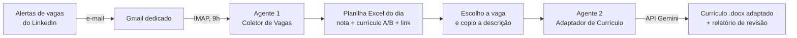

# Agente de Recolocação Profissional

Dois agentes em Python que automatizam a minha própria busca de emprego: um **coleta e pontua vagas todos os dias** e o outro **gera um currículo em Word adaptado para cada vaga, com IA (Google Gemini) e verificação contra invenções**.

Criei este projeto durante a minha transição de **Qualidade e Processos** para **Tecnologia**. Apliquei nele a mesma lógica que usei por anos em Sistemas de Gestão ISO: mapear o processo manual, identificar desperdícios, automatizar, medir e documentar em POP.

---

## O problema

Buscar vaga manualmente consumia tempo todos os dias:

- abrir o LinkedIn e rolar dezenas de vagas, muitas repetidas ou fora do perfil;
- decidir qual das minhas duas versões de currículo enviar (Qualidade/Processos ou Requisitos/Tecnologia);
- reescrever o currículo para cada vaga, com as palavras-chave certas para passar nos filtros (ATS), sem exagerar nem inventar nada.

## A solução



### Agente 1: Coletor de Vagas
- Roda sozinho **todos os dias às 9h** pelo Agendador de Tarefas do Windows.
- Lê os e-mails de alerta de vagas do LinkedIn em um **Gmail dedicado**, via IMAP.
- Extrai título, empresa, local e link de cada vaga e **descarta as já vistas** em dias anteriores.
- Calcula uma **nota de compatibilidade** por palavras-chave com peso (3 para termos que definem a vaga, 1 para termos de apoio), com bônus para Salvador/BA e trabalho remoto ou híbrido.
- Indica qual currículo enviar: **A (Qualidade & Processos)** ou **B (Requisitos & Tecnologia)**.
- Gera uma **planilha Excel** ordenada por nota, com link de candidatura e coluna de controle "Enviado?".

### Agente 2: Adaptador de Currículo
- Uso em 3 passos: copiar a descrição da vaga no LinkedIn (Ctrl + C) e dar dois cliques no atalho **Adaptar Currículo**.
- Faz uma **pontuação local** antes da IA: quantos % dos termos da vaga aparecem em cada currículo.
- O **Gemini** escolhe a versão A ou B e reescreve o currículo para a vaga.
- Pós-processamento automático:
  - passa para o passado os verbos de empregos já encerrados;
  - **verifica a veracidade** do texto gerado contra os currículos base: empresas, números, cursos, idiomas e verbos de responsabilidade como "liderei".
- Entrega um **currículo em Word (.docx)** e um **relatório** com compatibilidade antes/depois, palavras-chave, lacunas e alertas de veracidade.
- Registra cada adaptação num histórico (CSV) e, se a IA falhar, guarda a vaga como pendente para reprocessar.

## Destaques técnicos

| Desafio real | Solução adotada |
|---|---|
| Raspar o LinkedIn violaria os termos de uso | Leitura dos **alertas oficiais** que chegam por e-mail |
| Termos curtos casavam dentro de outras palavras (`ti` em "logística") | Comparação por **palavra inteira**, com texto normalizado (minúsculo e sem acento) |
| Termos genéricos traziam vagas fora do perfil | **Calibragem com 110 vagas reais**, ajuste de pesos e nota mínima |
| A IA "promovia" experiências ("liderei" onde era "acompanhei") ou inventava nível de idioma | **Verificação automática** contra os currículos base e alertas no relatório |
| Servidor do Gemini ocupado ou limite gratuito atingido | Nova tentativa automática, **troca de modelo** e fila de vagas pendentes |
| Erros invisíveis na execução agendada | Log em arquivo, saída sem buffer e tempo limite de 45 s na conexão |
| Senha perdida a cada atualização do código | Configuração e credenciais **externalizadas** em arquivo local |

## Tecnologias

| Item | Uso |
|---|---|
| Python | Linguagem dos dois agentes |
| IMAP (Gmail) | Leitura dos alertas de vagas |
| openpyxl | Planilha diária de vagas |
| Google Gemini API (`google-genai`) | Escolha da versão e reescrita do currículo |
| Word (.docx) | Currículo adaptado |
| Agendador de Tarefas do Windows + `.bat` | Execução diária e atalho de um clique |

## Decisões de projeto

- **Sem scraping.** O coletor usa os alertas oficiais do LinkedIn por e-mail.
- **Conta de e-mail dedicada.** Um eventual vazamento da senha de app atinge apenas uma caixa que só recebe alertas de vaga.
- **Veracidade acima de tudo.** O prompt proíbe inventar experiências, e o código confere o resultado. O revisor final continua sendo humano.
- **Privacidade (LGPD).** CPF, RG e endereço completo ficam fora dos currículos enviados à IA.
- **Custo zero.** Python, API gratuita do Gemini e Gmail.

## Resultados

- Calibragem da pontuação feita com **110 vagas reais** (agosto/2026).
- Volume diário típico: **5 a 15 vagas novas**, já filtradas e ordenadas.
- Exemplo real de adaptação: compatibilidade estimada pela IA de **35% → 85%**.

## Documentação

O projeto foi documentado como um sistema de gestão:

- [POP: Agente de Vagas](docs/POP_agente_de_vagas.md): configuração, rotina diária, calibragem, tabela de falhas e registro de melhorias.
- [Guia: Adaptador de Currículo](docs/guia_adaptador_curriculo.md): instalação, uso, checklist de revisão e solução de problemas.

## Estrutura

```
agente-recolocacao/
├── coletor/
│   ├── agente_vagas.py       # agente principal: lê, filtra, pontua e gera a planilha
│   ├── diagnostico.py        # testa o login e mostra o que há na conta de e-mail
│   ├── inspecionar.py        # mostra os links de vaga encontrados em cada e-mail
│   ├── rodar_agente.bat      # execução diária pelo Agendador, com log
│   ├── testar_agora.bat      # execução manual, mostrando tudo na tela
│   ├── config.example.txt    # modelo de configuração (sem senha)
│   └── requirements.txt
├── adaptador/
│   ├── adaptador.py          # pontuação, chamada ao Gemini, verificação e geração do .docx
│   ├── instalar.bat          # instala bibliotecas e abre o assistente de configuração
│   ├── colar_vaga.bat        # adapta a vaga copiada com Ctrl + C
│   ├── adaptar_vagas.bat     # processa as vagas salvas na pasta "vagas"
│   ├── adaptar_vagas_agendado.bat
│   ├── testar.bat            # confere configuração, currículos e conexão
│   ├── criar_atalho.bat      # cria o atalho na Área de Trabalho
│   ├── config_adaptador.example.txt
│   ├── requirements.txt
│   └── LEIA-ME.txt
└── docs/
    ├── POP_agente_de_vagas.md
    └── guia_adaptador_curriculo.md
```

## Como executar

1. Instale o Python 3 marcando **Add python.exe to PATH**.
2. **Coletor:**
   ```
   cd coletor
   pip install -r requirements.txt
   copy config.example.txt config.txt
   ```
   Preencha o Gmail e a senha de app no `config.txt` e rode:
   ```
   python agente_vagas.py --debug
   ```
   Para rodar todo dia às 9h, agende o `rodar_agente.bat` no Agendador de Tarefas do Windows. Detalhes no [POP](docs/POP_agente_de_vagas.md).
3. **Adaptador:** dentro da pasta `adaptador`, dê dois cliques em `instalar.bat`. Ele instala as bibliotecas e abre um assistente que pede a chave gratuita do Gemini, os dados de contato e os currículos base em Word. Depois, copie uma vaga (Ctrl + C) e rode `colar_vaga.bat`. Detalhes no [guia](docs/guia_adaptador_curriculo.md).

## Aprendizados

- Integrar Python com e-mail (IMAP), Excel, Word e uma API de IA generativa.
- Engenharia de prompt com restrições e, principalmente, **verificar a saída da IA em código** em vez de confiar nela.
- Tratar falhas reais de operação: limite de API, modelo indisponível, arquivo aberto, PC desligado no horário agendado.
- Aplicar PDCA a uma automação: medir, calibrar com dados reais, documentar e registrar as melhorias.

## Próximos passos

- [ ] Adaptar automaticamente as vagas de maior nota da planilha.
- [ ] Painel com histórico de candidaturas e taxa de retorno.

---

**Pedro Henrique Simas**: Qualidade, Processos e Requisitos | Salvador, BA  
[LinkedIn](https://www.linkedin.com/in/pedro-henrique-simas/)
